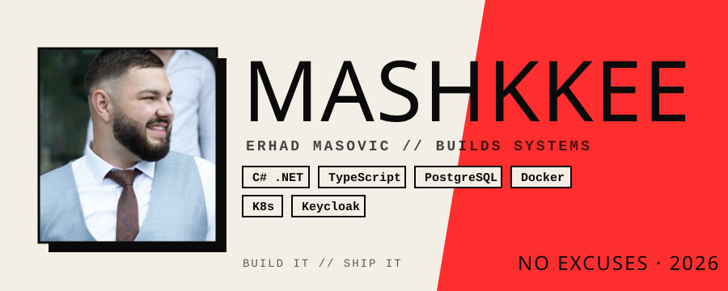
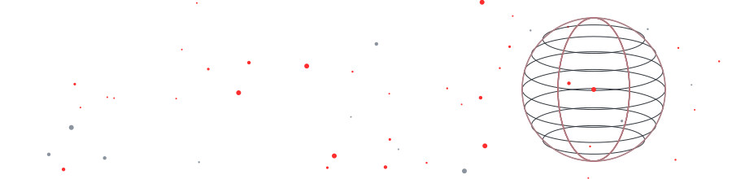

<div align="center">

<picture>
  <source media="(prefers-color-scheme: dark)" srcset="dark_mode.svg">
  
</picture>



[](https://readme-typing-svg.demolab.com)

</div>

---

<h3 align="center">⚡ MANIFESTO ⚡</h3>

```diff
+ Ship the thing. Then ship the next thing.
+ Read the code before you argue with it.
+ A system that needs a human to babysit it is a broken system.
- Hand-written boilerplate for every module. Never again.
- "It works on my machine." Not an answer.
```

---

<h3 align="center">🧰 ARSENAL</h3>

<p align="center">
  
  
  
  
  
  
  
  
</p>

---

<h3 align="center">📊 THE NUMBERS</h3>

<p align="center">
  
  
</p>

<p align="center">
  
</p>

---

<h3 align="center">🎯 RULES OF ENGAGEMENT</h3>

<div align="center">

| | |
|:---:|:---|
| 🔥 | **Quality over velocity.** Fast and wrong is still wrong. |
| 🧱 | **Boundaries are law.** Contracts between systems, never shortcuts through them. |
| 🛠️ | **Automate the repetitive, document the decisions.** |
| 🩸 | **Find the bug before the user does.** |

</div>

---

<div align="center">


</div>
