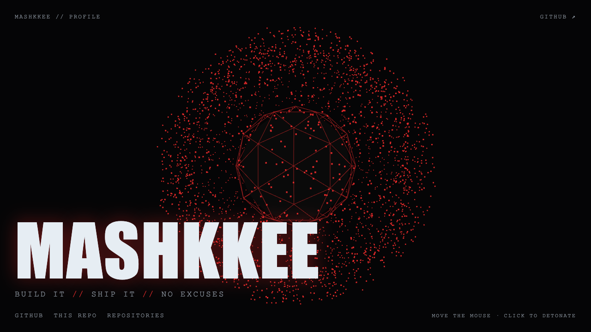

<picture>
  <source media="(prefers-color-scheme: dark)" srcset="dark_mode.svg">
  
</picture>

 

**[▶ OPEN THE INTERACTIVE PROFILE](https://mashkkee.github.io/mashkkee/)**

live three.js scene · move the mouse · click to detonate

  

---

### 🧰 Stack

### 📊 Stats

### 🔗 Links

[GitHub](https://github.com/mashkkee) · [This repo](https://github.com/mashkkee/mashkkee) · [Interactive profile](https://mashkkee.github.io/mashkkee/)

