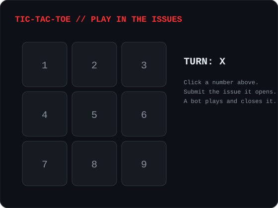
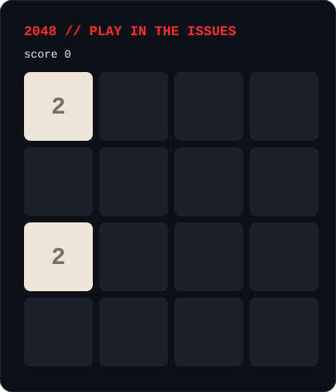

<picture>
  <source media="(prefers-color-scheme: dark)" srcset="dark_mode.svg">
  
</picture>

**[▶ OPEN THE 3D PROFILE](https://mashkkee.github.io/mashkkee/)**

live three.js scene · move the mouse · click to detonate

**[ 🧭 ABOUT ](#-about)** · **[ 🧰 STACK ](#-stack)** · **[ 📊 STATS ](#-stats)** · **[ 📫 CONTACT ](#-contact)**

---

## 🎮 Play: tic-tac-toe in the issues

Click a number. GitHub opens a new issue; press **Submit new issue**. A bot plays your move, replies, and closes it. Turns alternate X then O, and anyone can play either side.

| [**1**](https://github.com/mashkkee/mashkkee/issues/new?title=ttt%201) | [**2**](https://github.com/mashkkee/mashkkee/issues/new?title=ttt%202) | [**3**](https://github.com/mashkkee/mashkkee/issues/new?title=ttt%203) |
| :---: | :---: | :---: |
| [**4**](https://github.com/mashkkee/mashkkee/issues/new?title=ttt%204) | [**5**](https://github.com/mashkkee/mashkkee/issues/new?title=ttt%205) | [**6**](https://github.com/mashkkee/mashkkee/issues/new?title=ttt%206) |
| [**7**](https://github.com/mashkkee/mashkkee/issues/new?title=ttt%207) | [**8**](https://github.com/mashkkee/mashkkee/issues/new?title=ttt%208) | [**9**](https://github.com/mashkkee/mashkkee/issues/new?title=ttt%209) |

[**↺ reset the board**](https://github.com/mashkkee/mashkkee/issues/new?title=ttt%20reset)

The board image refreshes once GitHub's image cache catches up, usually within a few minutes.

---

## 🔢 Play: 2048 in the issues

Click a direction. GitHub opens a new issue; press **Submit new issue**. A bot slides the tiles, adds a new one, replies, and closes it.

| | [**▲ up**](https://github.com/mashkkee/mashkkee/issues/new?title=2048%20up) | |
| :---: | :---: | :---: |
| [**◀ left**](https://github.com/mashkkee/mashkkee/issues/new?title=2048%20left) | | [**right ▶**](https://github.com/mashkkee/mashkkee/issues/new?title=2048%20right) |
| | [**▼ down**](https://github.com/mashkkee/mashkkee/issues/new?title=2048%20down) | |

[**↺ new game**](https://github.com/mashkkee/mashkkee/issues/new?title=2048%20new)

Same as tic-tac-toe: the image refreshes once GitHub's image cache catches up.

---

## 🧭 About

<b>Who I am</b>

I build metadata-driven business applications: systems where objects, fields and screens are data, not hand-written code.

I care about boundaries between systems, contracts over shortcuts, and code that a second person can read.

<b>How I work</b>

- Tests pass, or nothing ships.
- Automate the repetitive, write down the decisions.
- A system that needs a human to babysit it is a broken system.

<b>What I am building now</b>

- An object platform for business applications (.NET API, TypeScript web client).
- Interactive profile experiments with three.js.

---

## 🧰 Stack

<b>Languages and frameworks</b>

<b>Data and infrastructure</b>

---

## 📊 Stats

<b>Open the numbers</b>

  
  

  

---

## 📫 Contact

<b>Find me</b>

- GitHub: [@mashkkee](https://github.com/mashkkee)
- This profile repo: [mashkkee/mashkkee](https://github.com/mashkkee/mashkkee)
- Interactive profile: [mashkkee.github.io/mashkkee](https://mashkkee.github.io/mashkkee/)

click any section above to expand it

